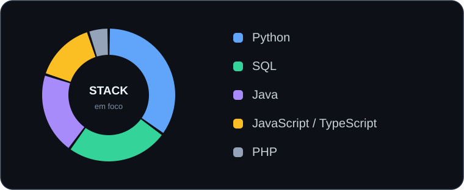

# Miguel de Oliveira Maciel

### Automação de Processos | Python | SQL | Desenvolvimento de Software

Técnico em Informática pelo **IFSULDEMINAS**  
Graduando em **Sistemas de Informação na UNIVÁS**

Desenvolvendo soluções que transformam processos manuais em fluxos mais eficientes, confiáveis e automatizados.

---

## Sobre mim

Sou formado como **Técnico em Informática pelo Instituto Federal do Sul de Minas Gerais (IFSULDEMINAS)** e atualmente curso **Sistemas de Informação na Universidade do Vale do Sapucaí (UNIVÁS)**.

Minha trajetória começou com uma formação prática em tecnologia, programação, infraestrutura e redes. Na graduação, venho aprofundando meus conhecimentos em desenvolvimento de software, banco de dados, modelagem de sistemas e integração de tecnologias.

Tenho experiência com suporte técnico e com o desenvolvimento de soluções voltadas à **automação de processos, tratamento de dados e redução de atividades manuais**, especialmente em rotinas administrativas, contábeis e fiscais.

Meu foco é desenvolver ferramentas que resolvam problemas reais, priorizando organização, confiabilidade e facilidade de utilização.

### Principais interesses

- Automação de processos com Python
- Consultas, modelagem e manipulação de bancos de dados
- Desenvolvimento Back-end
- Integração de sistemas e APIs
- Validação e conciliação de dados
- Engenharia de software e melhoria de processos

---

## Tecnologias e ferramentas

| Categoria | Tecnologias |
|:--|:--|
| **Linguagens** | Python, SQL, Java, JavaScript, TypeScript (em desenvolvimento), PHP |
| **Desenvolvimento Web** | HTML5, CSS3 |
| **Banco de Dados** | MySQL |
| **Interfaces e Integrações** | Tkinter, APIs REST, XML, CSV, JSON |
| **Ferramentas** | Git, GitHub, VS Code, MySQL Workbench, Excel |
| **Conhecimentos Complementares** | Cisco Packet Tracer, Arduino, Robótica, Linux, Redes TCP/IP, UML, Modelagem de Dados |

---

## Projetos e experiência prática

### Automação e soluções orientadas a dados

Atuo no desenvolvimento e aperfeiçoamento de soluções para otimização de rotinas operacionais.

Algumas das áreas em que desenvolvo projetos:

**Conciliação de documentos fiscais**
- Processamento de arquivos SPED Fiscal e XML de NF-e.
- Validação e comparação de informações fiscais.
- Identificação de divergências e geração de relatórios.

**Automação e conciliação de dados**
- Tratamento e padronização de dados estruturados.
- Conferência de registros financeiros e contábeis.
- Redução de preenchimentos e verificações manuais.

**Integração de sistemas e comunicação**
- Desenvolvimento de rotinas automatizadas.
- Utilização de APIs para integração de processos.
- Organização e validação de informações.

> Projetos profissionais apresentados de forma descritiva. Código-fonte, dados e informações corporativas são preservados conforme as respectivas autorizações.

### Projetos acadêmicos e atividades de extensão

<table>
<tr>
<td width="50%" valign="top">

**Cisco Packet Tracer — Redes e Infraestrutura**

Atividades práticas de simulação de redes no **Cisco Packet Tracer**, voltadas ao planejamento de topologias, endereçamento IP, conectividade entre dispositivos e diagnóstico de redes.

**Competências:** fundamentos de redes, TCP/IP, configuração e troubleshooting.

</td>
<td width="50%" valign="top">

**Robótica educacional — Ensino em escola**

Experiência ministrando **aulas de robótica em ambiente escolar**, aproximando conceitos de lógica, programação e tecnologia de atividades práticas.

**Competências:** comunicação técnica, ensino, robótica e resolução de problemas.

</td>
</tr>
<tr>
<td width="50%" valign="top">

**Robô Race — Arduino**

Projeto acadêmico com **Arduino** voltado à robótica, compartilhado em atividade de apresentação no **SESC**.

**Competências:** prototipagem, lógica de programação e sistemas embarcados.

</td>
<td width="50%" valign="top">

**Sistema de Biblioteca — MySQL**

Projeto acadêmico envolvendo modelagem e uso de banco de dados **MySQL** aplicado à organização de informações de uma biblioteca.

**Competências:** SQL, estruturação e persistência de dados.

</td>
</tr>
</table>

**Atividades com Linux** — experiências acadêmicas com sistemas operacionais, ambiente Linux e fundamentos de infraestrutura.

**[HayDay — Sistema de Gestão de Safra](https://github.com/mxciel006/HayDay)** — projeto acadêmico colaborativo em Java para gestão de uma fazenda fictícia, com cadastros, validações, persistência em arquivos e relatórios. Repositório mantido como *fork* do projeto original.

**[Aulas de Back-end](https://github.com/mxciel006/aulas-de-back-end)** — exercícios da formação técnica com PHP e fundamentos de integração com MySQL.

> Os projetos e atividades sem link de código estão apresentados como experiências acadêmicas. Não significam que seus arquivos estejam publicados neste GitHub.

---

## Linguagens e foco de atuação

O GitHub Readme Stats considera principalmente os repositórios públicos elegíveis e **não mede necessariamente minha experiência com cada linguagem**. Para representar também trabalhos profissionais e acadêmicos não publicados, apresento abaixo uma **distribuição editorial ilustrativa da minha stack**. Os percentuais indicam a ênfase que quero dar a cada tecnologia no portfólio, **não são porcentagens medidas de código**.

<picture>
  <source media="(max-width: 620px)" srcset="./assets/languages-pie-mobile.svg">
  
</picture>

**Python** — automação, validação e processamento de dados.  
**SQL / MySQL** — consultas, modelagem e análise de dados.  
**Java** — lógica, orientação a objetos e projetos acadêmicos.  
**JavaScript / TypeScript** — desenvolvimento web e tecnologias em estudo/uso.  
**PHP** — fundamentos de back-end desenvolvidos na formação técnica.

> Leitura do gráfico: Python 35% · SQL 25% · Java 20% · JavaScript/TypeScript 15% · PHP 5%. Esses pesos são ilustrativos e podem ser recalibrados com base em métricas reais de projetos, caso seus códigos sejam disponibilizados com autorização.

---

## Formação

**Bacharelado em Sistemas de Informação**  
Universidade do Vale do Sapucaí — UNIVÁS  
*Em andamento*

**Técnico em Informática**  
Instituto Federal de Educação, Ciência e Tecnologia do Sul de Minas Gerais — IFSULDEMINAS  
*Concluído em 2023*

---

## Contato

Estou aberto a conexões profissionais, colaboração técnica e troca de conhecimentos sobre desenvolvimento, automação e dados.

- **LinkedIn:** [Miguel Maciel](https://www.linkedin.com/in/miguel-maciel-657968337/)
- **GitHub:** [@mxciel006](https://github.com/mxciel006)
- **E-mail:** [maciel.miguel.tech@gmail.com](mailto:maciel.miguel.tech@gmail.com)

---

Desenvolvimento de software • Automação • Dados • Aprendizado contínuo

